# MARGARETE - RX580 OPTIMIZED

**[Português](#português)** · **[English](#english)**

> **Este repositório não contém arquivos, código ou recursos do jogo.** Você precisa da sua
> própria cópia. Não tem afiliação nem aprovação do desenvolvedor ou da distribuidora do jogo.
>
> **This repository contains no game files, code or assets.** You need your own copy of the
> game. It is not affiliated with or endorsed by the game's developer or publisher.

---

# Português

## Objetivo do projeto

O **VIctory** é uma camada de compatibilidade que roda um título de Xbox Series nativamente no
Windows, a partir dos arquivos que o próprio usuário fornece. O caminho é **portar, não
emular**: o renderizador do jogo é adaptado para se comportar como um renderizador de PC, e os
shaders do console são traduzidos antes, para DirectX 12.

O projeto do qual este repositório veio ([VIctory-7900XTX](https://github.com/avatarmanz/VIctory-7900XTX))
mira uma **Radeon RX 7900 XTX**. Este fork tem outro alvo: **fazer o jogo funcionar numa
Radeon RX 580** (GCN, 8 GB), uma placa de 2017 que não tem recursos que o jogo exige.

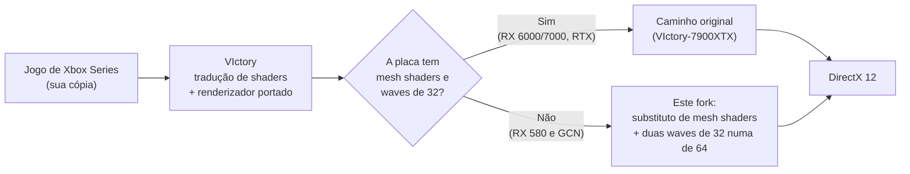

**Metas, em ordem:**
1. O jogo **desenhar** numa RX 580 (antes, o mundo inteiro era recusado).
2. Ficar **estável** dentro de 8 GB de VRAM e 32 GB de RAM.
3. Ganhar **desempenho** sem perder o que já funciona nas placas novas.

## Por que a RX 580 não rodava

A placa foi consultada direto pelo DirectX 12 nesta máquina:

| Recurso | RX 580 | O jogo precisa | Situação |
|---|---|---|---|
| Shader Model | 6.7 | 6.6 | ✅ suportado |
| Mesh shaders | **não** | sim (o mundo inteiro: 8.765 shaders) | ✅ **resolvido: substituto** |
| Waves de 32 lanes | **não** (só 64) | sim (parte dos compute shaders) | ✅ **resolvido: duas waves por wave** |
| Ray tracing | não | opcional (desligado por padrão) | ✅ não atrapalha |
| Enhanced barriers | não | opcional | ✅ o código já tem alternativa |
| Sparse textures (tier) | 2 | 2 | ✅ suportado |
| VRAM | 8 GB | ~10,5 GB (medido na 7900 XTX) | ⚠️ apertado |
| RAM (este PC) | 32 GB | ~30 GB (recomendado 64 GB) | ⚠️ apertado |

Comparada com os consoles e com a placa do projeto original (potência bruta, em TFLOPS FP32;
a RDNA rende mais por TFLOPS do que a GCN da RX 580):

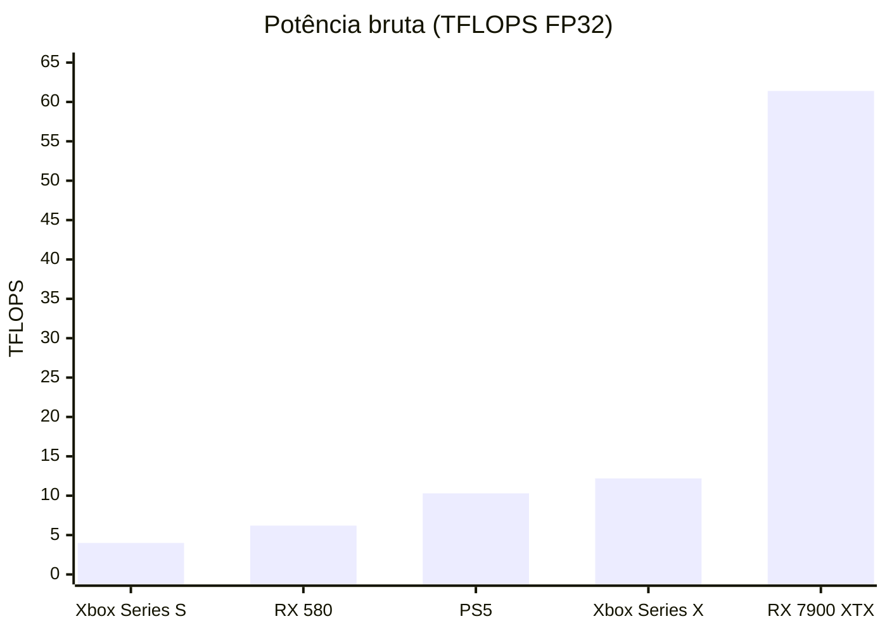

## O que foi feito

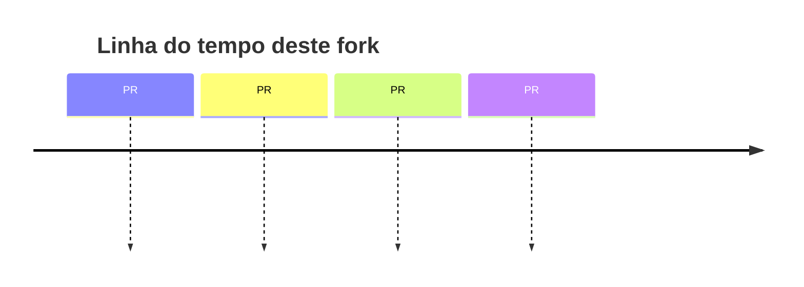

### 1. Substituto de mesh shaders (PR #1)

Sem mesh shaders, cada mesh shader do jogo vira **dois** shaders que a RX 580 executa: um
**compute shader** (o mesmo código traduzido, gravando vértices e triângulos num buffer) e um
**vertex shader gerado pelo tradutor**, que lê esse buffer e entrega tudo ao pixel shader do
jogo, sem mudanças. Placas com mesh shaders continuam no caminho original.

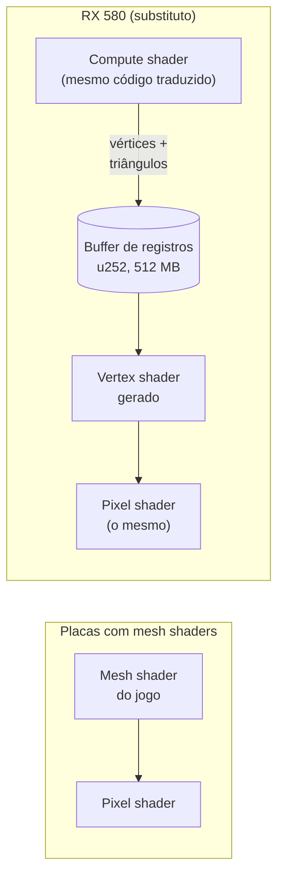

Quando o próprio jogo decide **na placa** quantos grupos desenhar (desenho indireto), o compute
shader deixa pronto, também na placa, o número de instâncias do desenho seguinte:

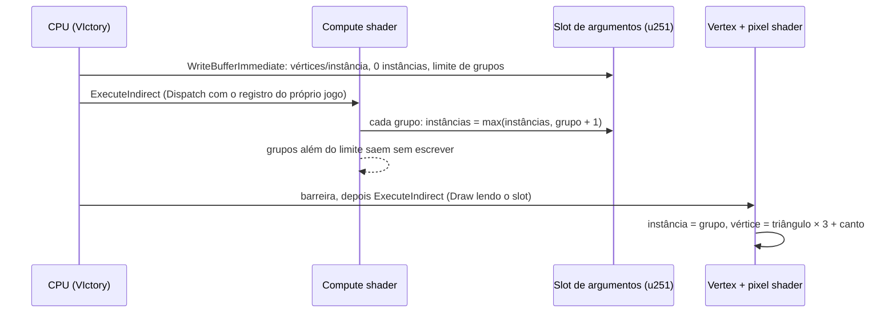

### 2. Waves de 32 lanes numa placa que só tem 64 (PR #2)

A RX 580 só executa waves de 64 lanes. Compute shaders do jogo feitos para waves de 32, cujas
lanes conversam entre si, eram recusados. Agora cada wave de 64 da placa carrega **duas waves
de 32 do console**, e toda operação entre lanes fica dentro da própria metade:

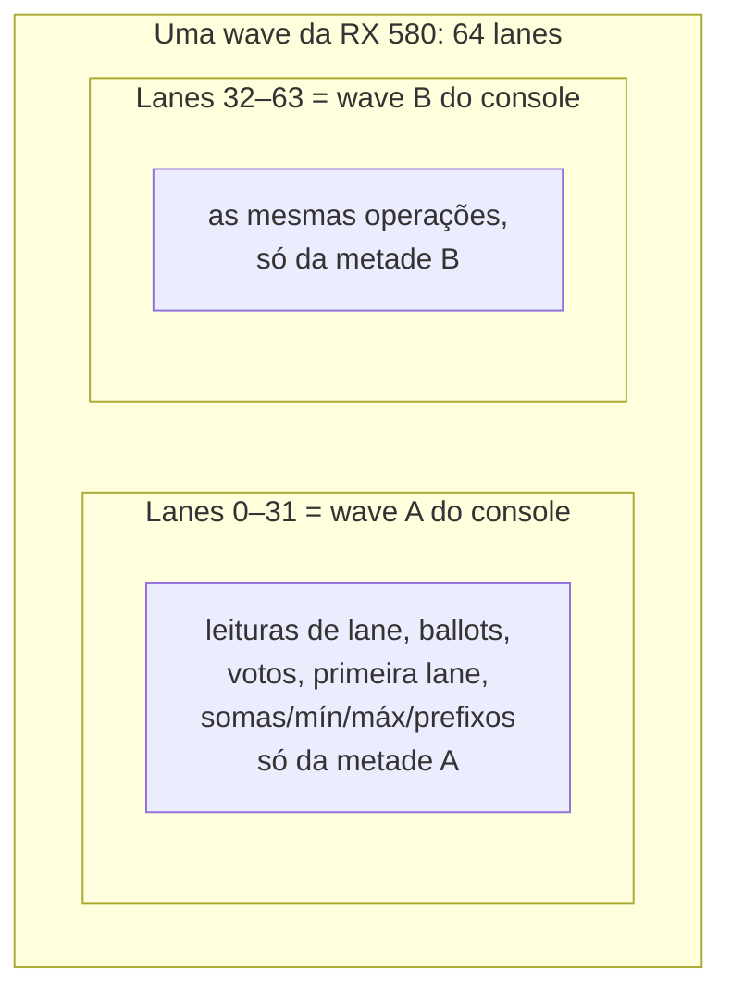

Reduções (soma, mínimo, máximo, operações de bits, somas de prefixo, somas em f64) são feitas
duas vezes: uma com só a metade de baixo (a de cima entra com o valor neutro) e outra ao
contrário, e cada lane fica com o resultado da sua metade.

### 3. Testes, barreiras e validação (PR #3)

- **Teste de descritores:** o driver da RX 580 guarda, na memória de um descritor, ponteiros do
  próprio driver (inclusive o endereço do slot). O teste comparava bytes que o D3D12 não
  promete; agora compara só onde os bytes são do descritor. **Não era bug do programa.**
- **Menos barreiras:** um desenho direto do substituto fazia **3** chamadas de barreira; agora
  faz **1**, e só sobre o buffer de registros.
- **Camada de debug do D3D12:** os testes que checavam "a camada de debug não achou erro" nunca
  podiam falhar (o próprio programa esvaziava a fila de mensagens antes). Isso foi corrigido, e
  a sequência do substituto passou **sem erros** com a validação na GPU e o rastreio de estados
  ligados. Dois erros colocados de propósito foram pegos.

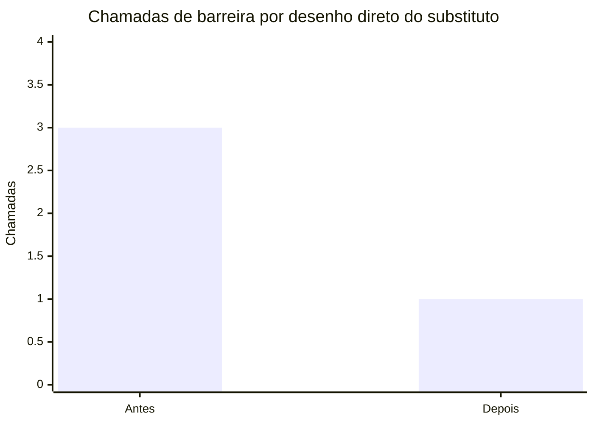

### Resultados dos testes na RX 580

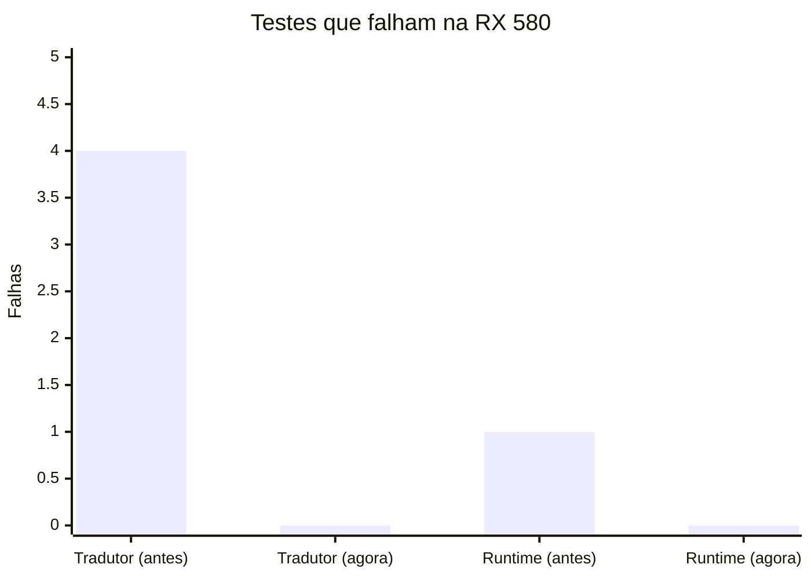

| Suíte | Antes deste fork, na RX 580 | Agora |
|---|---|---|
| Tradutor de shaders (`victory-shader`) | 299 passam, **4 falham** | **305 passam, 0 falham** |
| Runtime (`victory-gpu`) | 380 passam, **1 falha** | **383 passam, 0 falham** |
| Runtime com a camada de debug do D3D12 | (os testes não conseguiam ver erros) | **435 de 435** |
| Programa completo (`victory.exe`) | compila | compila |

Testes novos, rodando na RX 580: o substituto desenha exatamente o que o mesh shader desenha no
WARP (renderizador de referência da Microsoft), direto e indireto; duas waves de console por wave
da placa conferidas metade por metade; slots de argumentos lidos de volta da placa; a sequência
completa do substituto sob a camada de debug.

## Onde está e o que falta

> **Nada disso foi testado com o jogo ainda.** Tudo foi verificado com shaders sintéticos,
> na RX 580 e no WARP.

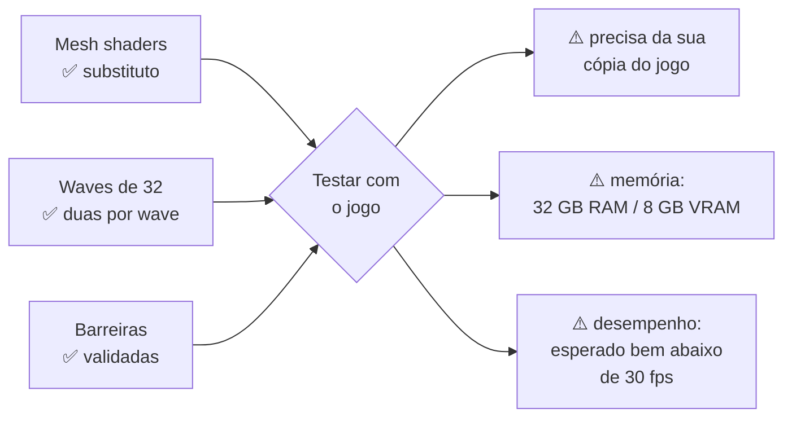

- **Teste com o jogo:** os 8.765 mesh shaders e ~2.600 compute shaders do jogo podem ter casos
  que os testes sintéticos não cobrem. Se a ligação entre o vertex shader gerado e um pixel
  shader do jogo for recusada, o pipeline é recusado e registrado no log (o programa não trava),
  e aquele objeto não aparece.
- **Memória:** o jogo usou ~30 GB de RAM e ~10,5 GB de VRAM na máquina do projeto original.
  `VICTORY_MESH_RING_MB=256` reduz o buffer do substituto pela metade.
- **Desempenho:** a RX 580 é cerca de 5 a 6 vezes mais fraca que a 7900 XTX (que faz ~22 fps), e
  o substituto custa mais que mesh shaders de verdade. Algo como 3 a 6 fps é o esperado.
- **Simplificações:** desenhos de mesh muito grandes são cortados ao que cabe no buffer (com
  aviso no log); execuções indiretas de mesh com vários registros de uma vez são descartadas
  (o jogo usa só registros únicos).

## Números do projeto original (RX 7900 XTX)

Medidos pelo projeto original numa única máquina: Windows 11, i9-12900K, 64 GB de RAM,
RX 7900 XTX, ray tracing desligado. **Não são da RX 580.**

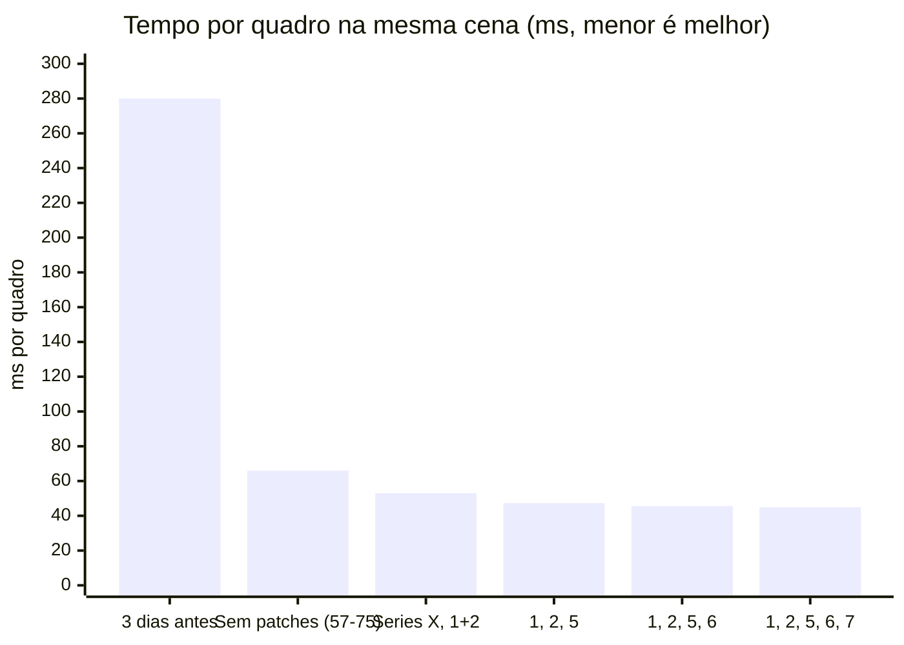

| | |
|---|---|
| Rua da cidade, perfil Series S, patches 1, 2, 5, 6 e 7 | ~45 ms por quadro (~22 fps) |
| Mesma cena antes dos patches | 57–75 ms (13–17 fps) |
| Shaders do jogo que traduzem | todos os usados (25.790 de 25.985; o resto são geometry shaders não usados) |
| Memória | ~30 GB de RAM e 10,5 GB de VRAM: **64 GB de RAM recomendados** |

O que limita o quadro lá é a thread que envia o trabalho do jogo para a placa (~40 ms); a
placa precisa de ~36 ms.

## Como rodar

Windows 10/11 x64, CPU com AVX2, placa DirectX 12 com Shader Model 6.6 (com ou sem mesh
shaders), Rust (a versão é fixada pelo projeto), Visual Studio Build Tools (C++) e a sua cópia
do jogo.

```powershell
git clone https://github.com/marcoscostaengineer/MARGARETE-RX580-OPTIMIZED
cd MARGARETE-RX580-OPTIMIZED
copy victory.example.toml victory.toml      # depois ajuste os caminhos, fora desta pasta
cargo build --locked --profile diag -p victory --features diagnostics
scripts\play.ps1 -Exe <caminho do executável da sua cópia>
```

Antes da primeira vez (os dois podem ser parados e retomados):

```powershell
target\diag\victory.exe shaders <os arquivos de shaders>   # traduz todos os shaders, leva minutos
target\diag\victory.exe warm --used                        # pipelines já usados, para driver ou build novos
```

`scripts\play.ps1 -Safe` deixa de fora os caminhos mais novos; use primeiro se algo der errado.
Em PC com duas placas, `VICTORY_D3D12_ADAPTER` escolhe a placa (índice DXGI ou parte do nome).

### Chaves deste fork

| Chave | O que faz |
|---|---|
| `VICTORY_MESH_SUBSTITUTE` | Substituto de mesh shaders: automático (só sem mesh shaders); `1` liga em qualquer placa, `0` nunca |
| `VICTORY_MESH_RING_MB` | Tamanho do buffer de registros do substituto (512 por padrão) |
| `VICTORY_D3D12_GBV_STATES=1` | Com `VICTORY_D3D12_DEBUG=1` e `VICTORY_D3D12_GBV=1`: mantém o rastreio de estados da validação na GPU (para testes) |

### Chaves herdadas do projeto original

| Chave | O que faz |
|---|---|
| `--console series-s` | Perfil Series S: saída em 1080p, ~5 ms mais rápido, imagem mais suave |
| `VICTORY_OUTPUT=1920x1080` | O jogo renderiza direto nesse tamanho (perfil Series X; ~16 ms a menos na placa) |
| `VICTORY_FRAME_INTERVAL_MS=16.667` | Deixa o jogo passar de 30 fps (menus e vídeos chegam a 60) |
| `VICTORY_AMBIENT_SETTLE` | Rapidez com que a luz se ajusta ao entrar em lugares fechados (`250,3` por padrão; `0` desliga) |
| `VICTORY_TEXTURE_STORE=1` | Guarda texturas convertidas entre execuções (por ora ~8 ms por quadro: desligado) |
| `VICTORY_PORT_CONSTANTS=1` | A placa lê o heap de constantes do jogo (174 MB) onde o jogo escreve |
| `VICTORY_PORT_DESCRIPTORS=1` | As gravações de tabelas de descritores do jogo informam os slots que escrevem |
| `VICTORY_PORT_CBV=1` | Shaders leem constant buffers no lugar, como bytes brutos (−4,7 ms) |
| `VICTORY_PORT_GUARD=1` | Trava das proteções de escrita dividida por bloco de 64 KiB (−2 ms) |
| `VICTORY_PORT_JOURNAL=1` | Registros dos heaps pedidos no submit do jogo, em 64 partes (−1 a −3 ms) |

Todas as chaves `VICTORY_...` estão descritas num comentário onde são lidas. Comandos e chaves de
depuração: [docs/README-fxceless.md](docs/README-fxceless.md); medições e motivos:
[docs/findings.md](docs/findings.md).

## Problemas conhecidos (herdados)

- Árvores, placas e objetos distantes piscam em alguns lugares.
- A iluminação fica clara ou escura demais ao entrar em lugares fechados, até o jogo rodar um
  tempo; cômodos com pouca luz direta ficam escuros demais sem `-RayTracing`.
- Texturas do que acabou de aparecer chegam atrasadas enquanto o jogo carrega.
- A primeira execução de um build novo engasga enquanto o driver cria pipelines (`victory warm`
  faz isso antes).
- Gravar um quadro no mundo faz o watchdog do próprio jogo encerrá-lo.

## Créditos

Isto é uma árvore de trabalho de outras pessoas, com mais coisa em cima. O histórico é mantido,
e commits trazidos de outros lugares citam o commit e o autor.

- **[VIctory-7900XTX](https://github.com/avatarmanz/VIctory-7900XTX)** por avatarmanz: o fork
  de onde este partiu (patches do renderizador, shaders traduzidos antes, tudo medido na RX 7900 XTX).
- **[VIctory](https://github.com/Marvisak/VIctory)** por Marvisak e colaboradores: o loader, os
  serviços do runtime, o back end Direct3D 12 e o recompilador de shaders.
- **[fxceless/victory-fork](https://github.com/fxceless/victory-fork)** e as pessoas cujos pull
  requests ele carrega.
- **[DexNom/VIctory](https://github.com/DexNom/VIctory)**: correções de ray tracing, gradientes
  de cubo, sparse textures.
- **[Belobug/VIctory-Belobug-AMD](https://github.com/Belobug/VIctory-Belobug-AMD)**: a ideia da
  luz ambiente, workers de pipeline e trabalho de romainhedouin.
- **[FQY55kai/ZJOU-VICTORY](https://github.com/FQY55kai/ZJOU-VICTORY)**.
- **[myokex/victory-amd](https://github.com/myokex/victory-amd)**: a proteção sobre todas as
  views de uma página (com Spexivus, joroyt e tightfall) e as leituras na memória do jogo de Joshua Odom.
- **Geckomacabre** e **cxy0072019-sketch**: a leitura de volta de texturas.
- **[XCL](https://github.com/ivall/xcl)** (GPL-2.0-only) foi lido para entender como o mesmo
  jogo se comporta em outra camada; nenhum código dele está aqui.
- As mudanças deste fork foram feitas com [Claude Code](https://claude.com/claude-code).

## Licença

GPL-3.0-or-later, como o VIctory. Veja [LICENSE](LICENSE); o único arquivo não coberto está
em [docs/asset-policy.md](docs/asset-policy.md).

---

# English

## Project goal

**VIctory** is a compatibility layer that runs an Xbox Series title natively on Windows from
files the user supplies. The way there is **porting, not emulating**: the title's renderer is
patched to behave as a PC renderer does, and the console's shaders are translated ahead of
time to DirectX 12.

The project this one comes from ([VIctory-7900XTX](https://github.com/avatarmanz/VIctory-7900XTX))
aims at a **Radeon RX 7900 XTX**. This fork aims elsewhere: **making the title run on a Radeon
RX 580** (GCN, 8 GB), a 2017 card without features the title needs.

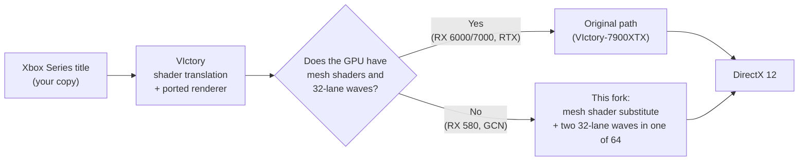

**Goals, in order:**
1. The title **draws** on an RX 580 (its whole world used to be refused).
2. It stays **stable** within 8 GB of VRAM and 32 GB of RAM.
3. **Performance**, without losing what already works on newer cards.

## Why the RX 580 could not run it

The card was queried through DirectX 12 on this machine:

| Feature | RX 580 | The title needs | Status |
|---|---|---|---|
| Shader Model | 6.7 | 6.6 | ✅ supported |
| Mesh shaders | **no** | yes (the whole world: 8,765 shaders) | ✅ **solved: substitute** |
| 32-lane waves | **no** (64 only) | yes (some compute shaders) | ✅ **solved: two waves per wave** |
| Ray tracing | no | optional (off by default) | ✅ not in the way |
| Enhanced barriers | no | optional | ✅ the code has a fallback |
| Sparse textures (tier) | 2 | 2 | ✅ supported |
| VRAM | 8 GB | ~10.5 GB (measured on the 7900 XTX) | ⚠️ tight |
| RAM (this PC) | 32 GB | ~30 GB (64 GB recommended) | ⚠️ tight |

Compared with the consoles and the original project's card (raw FP32 TFLOPS; RDNA does more per
TFLOPS than the RX 580's GCN):


## What was done

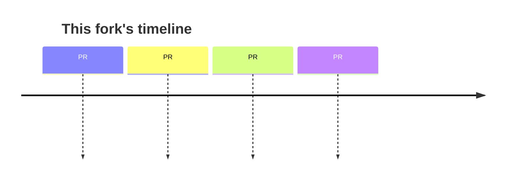

### 1. Mesh shader substitute (PR #1)

Without mesh shaders, each of the title's mesh shaders becomes **two** shaders the RX 580
runs: a **compute shader** (the same translated code, writing vertices and triangles into a
buffer) and a **vertex shader the translator generates**, which reads that buffer and hands
everything to the title's unchanged pixel shader. Cards with mesh shaders keep the original path.

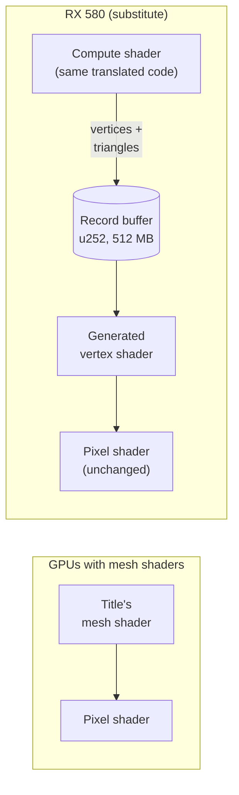

When the title itself decides **on the GPU** how many groups to draw (indirect draws), the
compute shader leaves the next draw's instance count ready, on the GPU too:

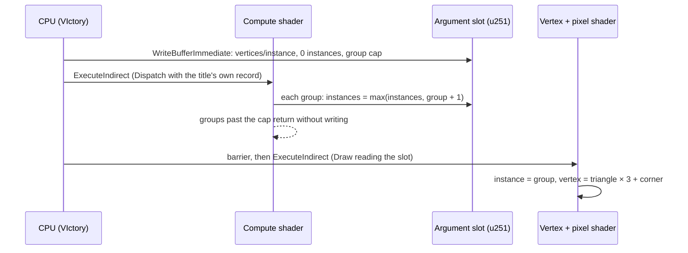

### 2. 32-lane waves on a GPU with 64 only (PR #2)

The RX 580 runs 64-lane waves only. The title's compute shaders written for 32-lane waves whose
lanes talk to each other were refused. Now each 64-lane GPU wave carries **two 32-lane console
waves**, and every cross-lane operation stays inside its own half:

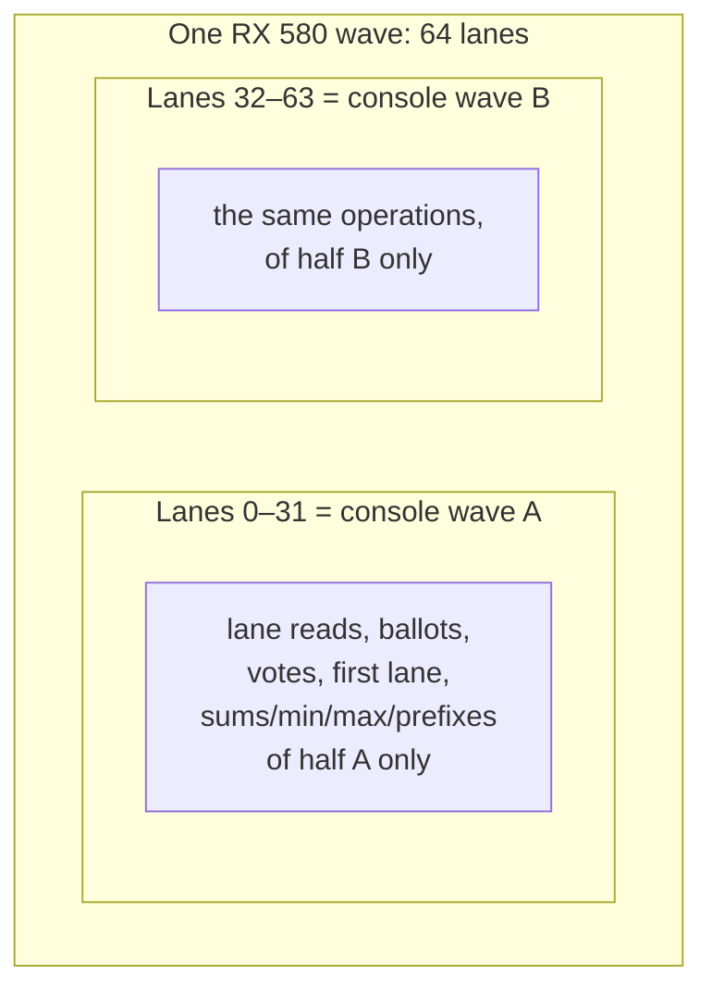

Reductions (sum, minimum, maximum, bit operations, prefix sums, f64 sums) run twice: once with
the lower half alone (the upper half gives the identity) and once the other way, and each lane
keeps its own half's result.

### 3. Tests, barriers and validation (PR #3)

- **Descriptor test:** the RX 580 driver keeps its own pointers (the slot's own address among
  them) in a descriptor's CPU memory. The test compared bytes D3D12 makes no promise about; it
  now compares only where the bytes are the descriptor's. **It was not a bug in the program.**
- **Fewer barriers:** a direct substitute draw made **3** barrier calls; it now makes **1**, on
  the record buffer alone.
- **D3D12 debug layer:** the tests asserting "the debug layer found no error" could never fail
  (the program emptied the message queue first). That is fixed, and the substitute's sequence
  passed **with no errors** under GPU-based validation with state tracking. Two deliberate
  faults were caught.

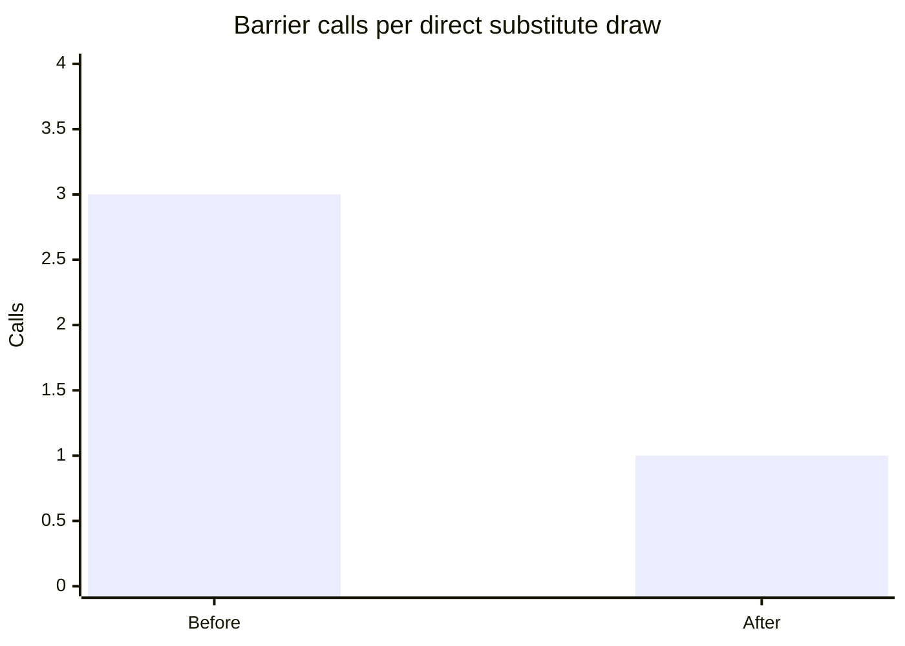

### Test results on the RX 580

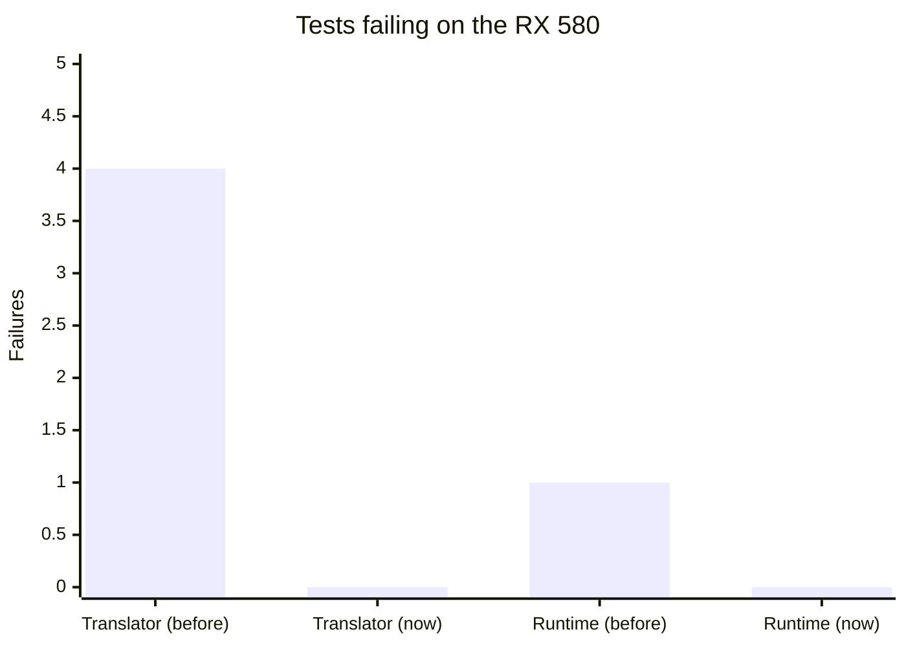

| Suite | Before this fork, on the RX 580 | Now |
|---|---|---|
| Shader translator (`victory-shader`) | 299 pass, **4 fail** | **305 pass, 0 fail** |
| Runtime (`victory-gpu`) | 380 pass, **1 fails** | **383 pass, 0 fail** |
| Runtime under the D3D12 debug layer | (the tests could not see errors) | **435 of 435** |
| Full program (`victory.exe`) | builds | builds |

New tests, run on the RX 580: the substitute draws exactly what the mesh shader draws on WARP
(Microsoft's reference renderer), direct and indirect; two console waves per GPU wave checked
half by half; argument slots read back from the card; the whole substitute sequence under the
debug layer.

## Where it stands and what is missing

> **None of this has been tested with the title yet.** Everything was checked with synthetic
> shaders, on the RX 580 and on WARP.

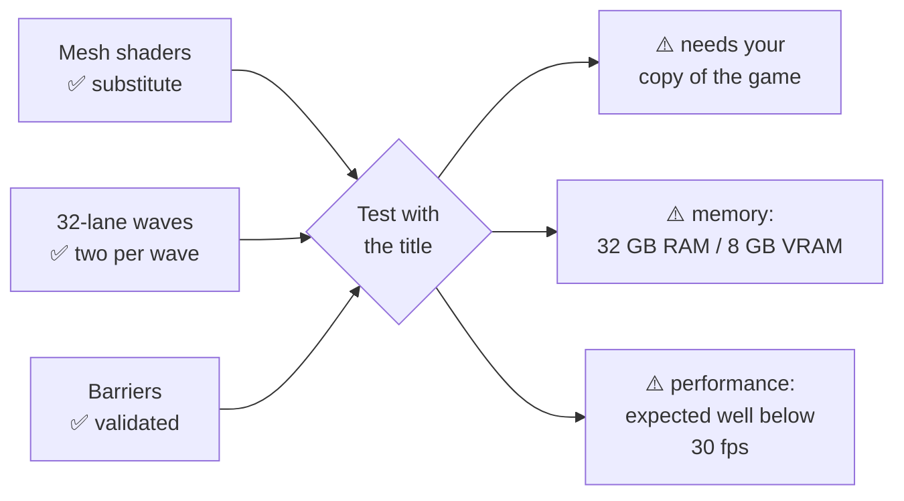

- **Testing with the title:** its 8,765 mesh shaders and ~2,600 compute shaders may hold cases
  the synthetic tests do not. If the link between the generated vertex shader and one of the
  title's pixel shaders is refused, that pipeline is refused and logged (the program does not
  crash), and that object does not show.
- **Memory:** the title used ~30 GB of RAM and ~10.5 GB of VRAM on the original project's
  machine. `VICTORY_MESH_RING_MB=256` halves the substitute's buffer.
- **Performance:** the RX 580 is about 5 to 6 times weaker than the 7900 XTX (which does ~22
  fps), and the substitute costs more than real mesh shaders. Something like 3 to 6 fps is
  expected.
- **Shortcuts:** very large mesh draws are cut to what fits in the buffer (logged); indirect mesh
  executions of several records at once are dropped (the title uses single records).

## The original project's numbers (RX 7900 XTX)

Measured by the original project on one machine: Windows 11, i9-12900K, 64 GB of RAM, RX 7900
XTX, ray tracing off. **Not from the RX 580.**

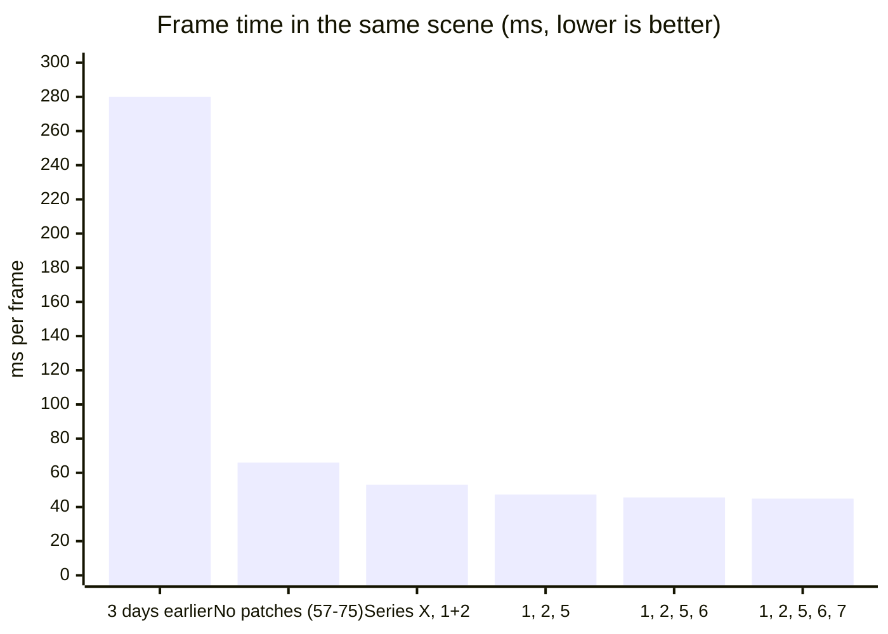

| | |
|---|---|
| City street, Series S profile, patches 1, 2, 5, 6 and 7 | ~45 ms a frame (~22 fps) |
| Same scene before the patches | 57–75 ms (13–17 fps) |
| The title's shaders that translate | every one used (25,790 of 25,985; the rest are unused geometry shaders) |
| Memory | ~30 GB of RAM and 10.5 GB of VRAM: **64 GB of RAM recommended** |

What sets the frame there is the thread that submits the title's work to the card (~40 ms);
the card needs ~36 ms.

## How to run it

Windows 10/11 x64, a CPU with AVX2, a DirectX 12 GPU with Shader Model 6.6 (with or without mesh
shaders), Rust (the project pins the version), the Visual Studio Build Tools (C++), and your own
copy of the title.

```powershell
git clone https://github.com/marcoscostaengineer/MARGARETE-RX580-OPTIMIZED
cd MARGARETE-RX580-OPTIMIZED
copy victory.example.toml victory.toml      # then set your paths, outside this folder
cargo build --locked --profile diag -p victory --features diagnostics
scripts\play.ps1 -Exe <path of your copy's executable>
```

Before the first run (both can be stopped and go on later):

```powershell
target\diag\victory.exe shaders <the shader archives>   # every shader translated, minutes
target\diag\victory.exe warm --used                     # pipelines earlier runs drew with, for a new driver or build
```

`scripts\play.ps1 -Safe` leaves out the newest ways; try it first when something is wrong. On a
PC with two GPUs, `VICTORY_D3D12_ADAPTER` picks one (a DXGI index or part of its name).

### This fork's switches

| Switch | What it does |
|---|---|
| `VICTORY_MESH_SUBSTITUTE` | Mesh shader substitute: automatic (only without mesh shaders); `1` on any GPU, `0` never |
| `VICTORY_MESH_RING_MB` | Size of the substitute's record buffer (512 by default) |
| `VICTORY_D3D12_GBV_STATES=1` | With `VICTORY_D3D12_DEBUG=1` and `VICTORY_D3D12_GBV=1`: keeps GPU-based validation's state tracking (for tests) |

### Switches from the original project

| Switch | What it does |
|---|---|
| `--console series-s` | Series S profile: 1080p output, ~5 ms faster, a softer picture |
| `VICTORY_OUTPUT=1920x1080` | The title renders to that size itself (Series X profile; ~16 ms less card time) |
| `VICTORY_FRAME_INTERVAL_MS=16.667` | Lets the title go above 30 fps (menus and videos reach 60) |
| `VICTORY_AMBIENT_SETTLE` | How fast light settles after walking indoors (`250,3` by default; `0` off) |
| `VICTORY_TEXTURE_STORE=1` | Converted textures kept between runs (~8 ms a frame for now: off) |
| `VICTORY_PORT_CONSTANTS=1` | The card reads the title's 174 MB constants heap where the title writes it |
| `VICTORY_PORT_DESCRIPTORS=1` | The title's descriptor-table stores report the slots they write |
| `VICTORY_PORT_CBV=1` | Shaders read constant buffers in place as raw bytes (−4.7 ms) |
| `VICTORY_PORT_GUARD=1` | The write guards' lock split per 64 KiB block (−2 ms) |
| `VICTORY_PORT_JOURNAL=1` | The heaps' records asked for at the title's submit, in 64 parts (−1 to −3 ms) |

Every `VICTORY_...` switch is described in a comment where it is read. Commands and debugging
switches: [docs/README-fxceless.md](docs/README-fxceless.md); measurements and reasons:
[docs/findings.md](docs/findings.md).

## Known problems (inherited)

- Trees, signs and far objects flicker in the distance in some places.
- Lighting is too bright or too dark after walking indoors, until the title has run for a
  while; rooms with little direct light are too dark without `-RayTracing`.
- Textures of what just came into view appear late while the title streams.
- The first run of a new build stutters while the driver makes pipelines (`victory warm` makes
  them ahead).
- Recording a frame in the world makes the title's own watchdog end it.

## Credits

This is a tree of other people's work with more on top. The history is kept, and commits taken
from elsewhere name the commit and its author.

- **[VIctory-7900XTX](https://github.com/avatarmanz/VIctory-7900XTX)** by avatarmanz: the fork
  this one started from (renderer patches, ahead-of-time shaders, everything measured on the RX 7900 XTX).
- **[VIctory](https://github.com/Marvisak/VIctory)** by Marvisak and its contributors: the
  loader, the runtime services, the Direct3D 12 back end and the shader recompiler.
- **[fxceless/victory-fork](https://github.com/fxceless/victory-fork)** and the people whose pull
  requests it carries.
- **[DexNom/VIctory](https://github.com/DexNom/VIctory)**: ray tracing fixes, cube gradients,
  sparse textures.
- **[Belobug/VIctory-Belobug-AMD](https://github.com/Belobug/VIctory-Belobug-AMD)**: the ambient
  light idea, pipeline workers, and work by romainhedouin.
- **[FQY55kai/ZJOU-VICTORY](https://github.com/FQY55kai/ZJOU-VICTORY)**.
- **[myokex/victory-amd](https://github.com/myokex/victory-amd)**: the guard over every view of a
  page (with Spexivus, joroyt and tightfall), and Joshua Odom's reads into title memory.
- **Geckomacabre** and **cxy0072019-sketch**: the texture read-back.
- **[XCL](https://github.com/ivall/xcl)** (GPL-2.0-only) was read for how the same title behaves
  under another layer; no code of it is here.
- This fork's changes were made with [Claude Code](https://claude.com/claude-code).

## License

GPL-3.0-or-later, as VIctory. See [LICENSE](LICENSE); the one file that is not covered is named
in [docs/asset-policy.md](docs/asset-policy.md).
